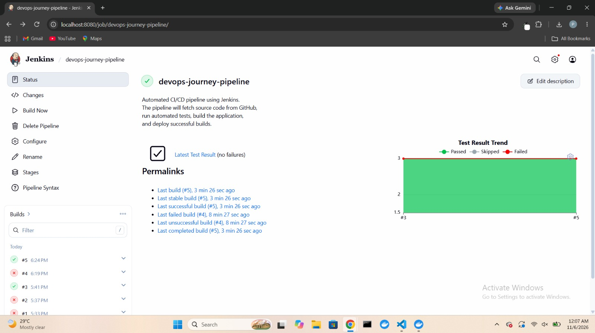
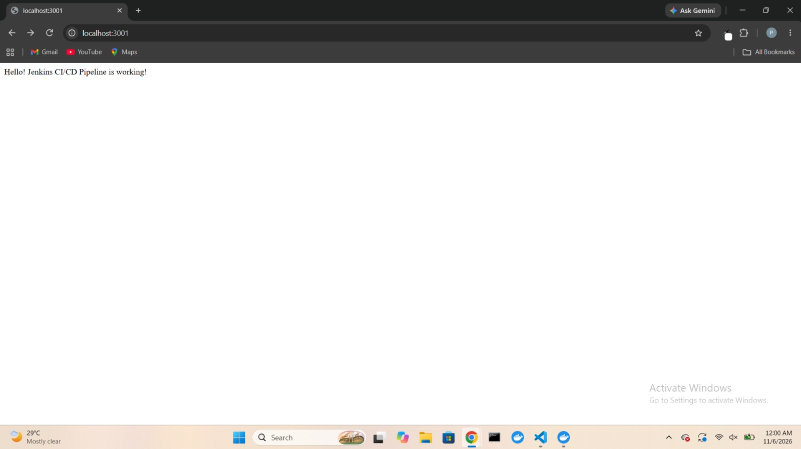
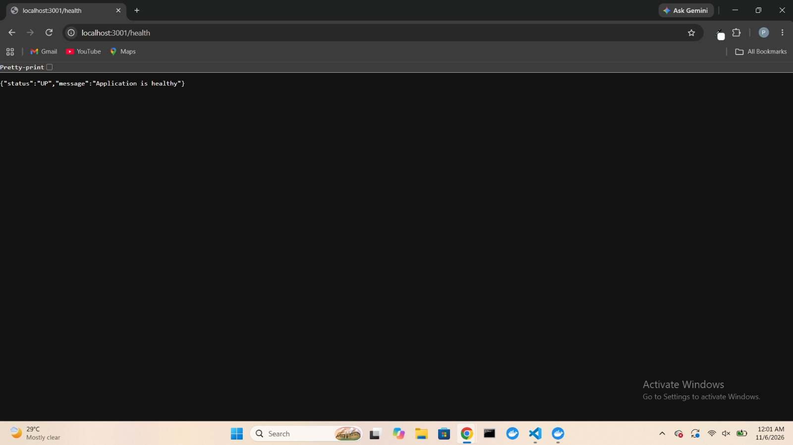

# Jenkins CI/CD Pipeline with Docker

## Project Overview

This project demonstrates an automated CI/CD pipeline using **Jenkins, GitHub, Node.js, Docker, and Docker Hub**.

Whenever code is pushed to GitHub, Jenkins checks out the source code, installs dependencies, runs automated tests, builds the application, creates a Docker image, and pushes the image to Docker Hub.

## Technologies Used

- Jenkins
- Git and GitHub
- Node.js
- Express.js
- Jest
- Docker
- Docker Hub
- PowerShell

## Project Structure

```text
Jenkins/
├── app/
│   ├── server.js
│   ├── server.test.js
│   ├── package.json
│   └── Dockerfile
├── screenshots/
│   ├── application-output.jpeg
│   ├── health-check.jpeg
│   └── jenkins-pipeline.jpeg
├── Jenkinsfile
├── Dockerfile
├── docker-compose.yml
└── README.md
```

## CI/CD Pipeline Stages

1. **Checkout:** Pulls source code from GitHub.
2. **Install Dependencies:** Installs Node.js application dependencies using `npm ci`.
3. **Run Tests:** Executes automated tests using Jest.
4. **Build:** Validates the application package.
5. **Docker Build:** Builds the Docker image with a build number and `latest` tag.
6. **Docker Hub Push:** Authenticates with Docker Hub and pushes both image tags.

## Application Endpoints

| Endpoint | Description |
|---|---|
| `/` | Displays the application welcome message |
| `/health` | Returns application health status |

## Run the Docker Container

Pull the image:

```bash
docker pull purnimajd20/jenkins-ci-cd-demo:latest
```

Run the container:

```bash
docker run -d --name jenkins-demo -p 3001:3000 purnimajd20/jenkins-ci-cd-demo:latest
```

Access the application:

- Application: http://localhost:3001
- Health Check: http://localhost:3001/health

## Screenshots

### Jenkins Pipeline



### Application Output



### Health Check



## Outcome

Successfully implemented an end-to-end Jenkins CI/CD pipeline that automates application testing, Docker image creation, and Docker Hub image publishing.

The application was deployed locally using the published Docker image, and both application and health-check endpoints were verified successfully.